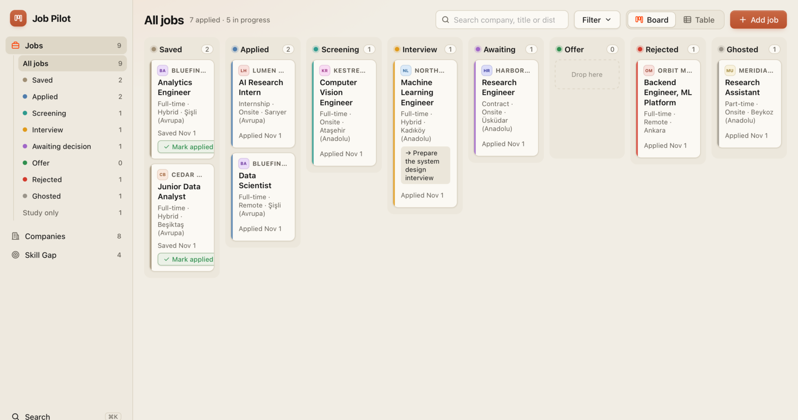
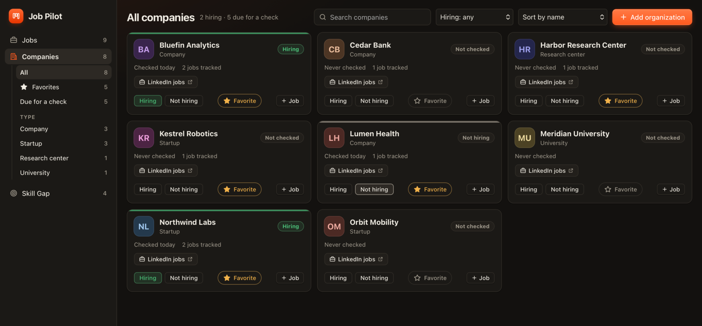
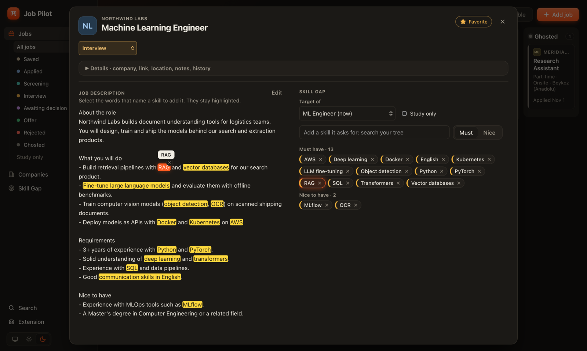
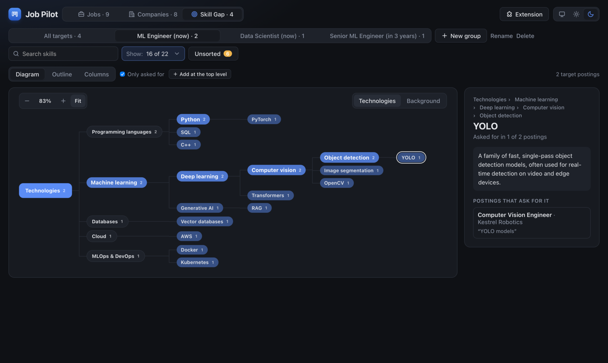

# Job Pilot

A local, single-user app for macOS and Windows for tracking job applications and for seeing what the roles you want require. Everything stays on your computer in one SQLite file. There are no accounts and no cloud, and nothing runs in the background.



## Features

- **One sidebar for the whole app.** Jobs, Companies and Skill Gap, each with its own lists folded under it (statuses, company types, the areas of your skill tree), and search, the Chrome extension and the theme at its foot. Each page has one slim header with its search, filters, view and create button.
- **Board and table views.** Track jobs on a kanban board with drag and drop, or in a sortable table.
- **Statuses.** A job moves through Saved, Applied, Screening, Interview, Awaiting decision (all interviews done, waiting for their answer), Offer, Rejected and Ghosted. The applied date is stamped the first time a job reaches Applied or a later stage.
- **Job details.** Every job keeps its status history, notes, a next action, the job URL, job type (full-time, part-time, internship, contract), work mode and source.
- **Save jobs from LinkedIn.** A Chrome extension adds a **Save to Job Pilot** button to LinkedIn job pages. One click saves the title, company, logo, location, work mode, job type and description, and the same posting is never saved twice. On a company or university page, the same button saves the company to your favorites. Whatever you save while Job Pilot is closed waits in the extension until you open the app.
- **Skill Gap.** See what the roles you want ask for, in a skill tree you design yourself. See [Skill Gap](#skill-gap) below.
- **Companies.** Every company you have interacted with is listed, whether it came in through a job or you added it by hand: companies, startups, research centers and universities. Star your **favorites**, open their careers page and LinkedIn jobs, and record whether they were hiring when you last checked. Companies not checked for two weeks are listed under **Due for a check**. "Acme AI" and "acme ai" count as the same company.
- **Company logos.** Add a company's website and its logo appears next to the name; without one, it gets a colored badge with its initials. Each logo is downloaded once and kept on your Mac.
- **Istanbul locations.** City defaults to Istanbul. Pick a district or just a side ("All of Anadolu Yakası") from a searchable list, or choose "Other city" and type it.
- **Search and filters.** Search by company, title or district (Cmd+K, or Ctrl+K on Windows, jumps to the search of the page you're on). Pick a status in the sidebar, and job type, work mode and location from **Filter**; what you pick shows as chips you can clear.
- **Light, night and system themes** in warm paper and ink with one signal orange, in a native window (macOS or Windows) with the usual shortcuts.



## How you use it

1. **Save a posting.** On LinkedIn, click **Save to Job Pilot**, or add the job by hand with **Add job**.
2. **Track it.** Drag it across the board as it moves from Saved to Applied, Interview and beyond. Its history, notes and next action stay with it.
3. **Make it a target.** For a role you are aiming at, now or later, open the job and choose a role group under **Skill Gap**.
4. **Pick its skills.** Select the words in the description that name a skill and press **Add as skill**.
5. **Sort new skills into your tree.** On the Skill Gap page, open **Unsorted** and place each new skill where it belongs.
6. **Read the gap.** The tree shows which skills the roles you want ask for most, so you know what to learn next.

## Skill Gap

### Targets and role groups

Make any job a **target** of a role group you name, like "AI Engineer (now)" or "Senior ML Engineer (in 3 years)". Its status doesn't matter. A job can also be kept **only to study the role**: it leaves the job board, and **Study only** under Jobs in the sidebar shows those jobs.

### Adding a job's skills

You connect each target to the skills it asks for by hand. Open the job: its description fills the left of the pop-up and its skills the right.

- **Select words in the description** and press **Add as skill**, or type in the search. The search finds the skill in your tree, showing where it sits, or adds a new one to Unsorted. Choose **Must have** or **Nice to have** as you add it; click a skill later to switch it.
- The words you selected stay highlighted, and only those words: the same words elsewhere in the description stay plain. Hover a highlight to see the skill's name, and its skill lights up on the right; hover a skill on the right and its words light up. The small × on a highlight takes the skill off the job.




### Unsorted

A skill your tree doesn't have yet waits in **Unsorted**. **Unsorted**, under Skill Gap in the sidebar, shows how many are waiting and opens them beside the tree, most asked for first, each with how many postings ask for it and the words it was picked from. **Place…** searches the tree for where it belongs, or drag it onto a node. To take a node out of the tree, drop it on Unsorted or its panel.


### The skill tree

The tree starts as a general skeleton for any field: **Technologies** (programming languages, databases, cloud, DevOps, software engineering, with common tools like Python and Docker marked as tools), an empty **Domain knowledge**, **Background** (experience, education, spoken languages) and **Soft skills**, hidden by default. You grow it from your own postings, general to specific (Technologies › Programming languages › Python › pandas), and only you change it.

- A node is one of three kinds, each with its own color:
  - a **concept**, orange: a kind of work or knowledge you can't point to, like Feature engineering or Computer vision;
  - a **tool**, ink (near-black by day, paper-white at night): something you can point to, like Docker, PyTorch or YOLO. Put it under the concept it is used for, so a posting asking for PyTorch also counts for Deep learning;
  - a **group**, outlined: it only organizes, like Cloud & infrastructure, and is never asked for itself.

  Concepts and tools are both asked for by postings and can hold other skills. Choose the kind when you add or edit a node.
- Each node counts the postings that ask for it or for anything under it. Its details say how many name it and how many name something under it, show its description and what is under it, and list the postings with the line each one asks for it in.
- Under Skill Gap in the sidebar: the role group (with New group, Rename and Delete), the **areas** of your tree with how many asked-for skills each holds (click one to open it; hover for the eye that hides it), **Unsorted**, and the color legend.
- See the area as a **diagram**, an **outline** with a bar per skill, or **columns** you browse one level at a time; a search looks through every area. Every view, and the details beside it, fills the window and scrolls on its own. The diagram sits on a dotted canvas you can drag freely in any direction; zoom and **Fit** sit in its corner.
- The **⋯** menu in the header holds **Only skills postings ask for** (what no posting asks for is otherwise drawn faint), the order (as in the tree, most asked for, or A–Z) and **Add at the top level**.



### Editing the tree

The page itself is the editor. Hover a node for:

- **+** to add a skill or group under it;
- the **pencil** to rename it (postings that use the old name still find it) or describe it. **Write with AI** writes a description from the skill's place in the tree, for you to edit before saving;
- the **trash** to remove it. A skill comes off the jobs connected to it. **Undo** in the notice that appears, or Cmd+Z (Ctrl+Z on Windows), brings it back while the app is open: in its place, with what was under it, its jobs and its description.

Double-click a node to edit it. Drag nodes in the diagram or the outline to move them, under another node or between two. Hold a dragged node over an area in the sidebar to open that area, or drop it on the area.

## AI

AI is optional: it only writes skill descriptions. Choose the model in the AI settings (the gear next to **Write with AI**):

- a local model through **Ollama** (free, nothing leaves your Mac);
- any **OpenAI-compatible API** (OpenAI, OpenRouter, Groq, Gemini, Mistral, LM Studio...);
- **Claude** with your own API key;
- **Claude Code**, which uses your Claude subscription with no API key. Pick the model and effort from a list (Opus 5.5 at medium effort by default). It needs Claude Code installed and logged in, runs with no tools or files, and counts toward your plan's usage limits.

API keys stay on your Mac in a file only you can read.

## Install

### macOS

Requires [uv](https://docs.astral.sh/uv/) and Node 20+.

```sh
cd frontend && npm install && cd ..
./packaging/build_app.sh
cp -R "dist/Job Pilot.app" /Applications/
```

Open **Job Pilot** from Spotlight or Launchpad.

### Windows

Windows 10 or 11. The installer is built on GitHub's Windows machines on every push to `main`:

1. On GitHub, open **Actions › Windows build**, pick the latest run and download **JobPilot-Windows** under Artifacts. Unzip it.
2. Run `JobPilot-Setup-<version>.exe`. The installer isn't signed, so Windows shows **"Windows protected your PC"**: click **More info**, then **Run anyway**. It installs for your user only, with no administrator rights, and adds Job Pilot to the Start menu.
3. Open **Job Pilot** from the Start menu.

To build it yourself on Windows, install [uv](https://docs.astral.sh/uv/), Node 20+ and [Inno Setup 6](https://jrsoftware.org/isinfo.php), then in PowerShell:

```powershell
cd frontend; npm install; cd ..
.\packaging\build_windows.ps1
```

This makes `dist\Job Pilot\Job Pilot.exe` and the installer `dist\JobPilot-Setup-<version>.exe`. The window uses Microsoft Edge WebView2, which comes with Windows 10 and 11.

### Chrome extension

1. In Job Pilot, click **Extension** at the foot of the sidebar, then **Open Chrome**. Chrome opens its extensions page, and the extension's folder location is copied for you.
2. In Chrome, turn on **Developer mode** and click **Load unpacked**. On macOS press Shift+Cmd+G, paste with Cmd+V, press Return and click **Select**; on Windows press Ctrl+L, paste with Ctrl+V, press Enter and click **Select Folder**.
3. The extension's settings open. Paste the key shown in Job Pilot's Extension dialog and click Save.

Chrome doesn't let apps install extensions themselves, so this is done once by hand. Publishing to the Chrome Web Store, which would make it a one-click install, is planned.

The extension only reads the job or company page you have open when you click its button. It never browses LinkedIn on its own. After updating the app, click **Open Chrome** again and press the reload button on the extension.

The app runs only while its window is open. Closing the window stops it completely, and nothing starts at login.

The app listens on port 8765, where the extension looks for it. If another program already uses that port, Job Pilot says which one and lets you quit or open anyway. If you open anyway, everything works except saving from LinkedIn, which waits until the port is free.

To update after code changes on macOS, rebuild and replace the installed copy (on Windows, run the new installer over the old one):

```sh
./packaging/build_app.sh
rm -rf "/Applications/Job Pilot.app" && cp -R "dist/Job Pilot.app" /Applications/
```

### Keyboard shortcuts

| macOS | Windows | Action |
| --- | --- | --- |
| Cmd+K | Ctrl+K | Search the page you're on |
| Cmd+M | Win+Down | Minimize |
| Cmd+W | Alt+F4 | Close window (quits the app) |
| Cmd+Q | Alt+F4 | Quit |
| Cmd+Z / Shift+Cmd+Z | Ctrl+Z / Ctrl+Y | Undo / Redo in text fields; on Skill Gap, outside a text field, undo brings back the last removed skill |
| Ctrl+Cmd+F | Win+Up | Full screen (maximize on Windows) |
| Esc | Esc | Close the add form or the job panel |

## Your data

Jobs are stored in:

```
macOS:    ~/Library/Application Support/JobPilot/jobpilot.db
Windows:  %APPDATA%\JobPilot\jobpilot.db
```

Uninstalling the app leaves this folder in place.

Downloaded company logos are kept in the `logos` folder next to it and are downloaded again if deleted.

The extension key is in `extension-key` in the same folder.

To back up, copy `jobpilot.db`. The app and the development server both use this same file. To use a different one, set `JOBPILOT_DB=/path/to/other.db`.

## Development

Run the backend and the UI with live reload:

```sh
./dev.sh          # macOS
.\dev.ps1         # Windows, in PowerShell
```

Then open http://127.0.0.1:5173.

### Ports

| | Default | Change with |
| --- | --- | --- |
| UI (Vite) | 5173 | `JOBPILOT_UI_PORT` |
| Backend (FastAPI) | 8766 | `JOBPILOT_PORT` |
| Installed app | 8765 | |

If another app is already using one of these ports, `dev.sh` says which process holds it and stops. To run on other ports:

```sh
JOBPILOT_UI_PORT=5180 JOBPILOT_PORT=8770 ./dev.sh
```

To see what is using a port: `lsof -nP -iTCP:5173 -sTCP:LISTEN`.

The installed app uses 8765 and `dev.sh` uses 8766, so both can run at the same time. To point the extension at the development server, set its port to 8766 under **Advanced** in the extension's settings. Both use the same database and extension key.

### Tests

```sh
cd backend && uv run pytest
```

### Schema changes

Edit `backend/src/jobpilot/models.py`, then generate a migration:

```sh
cd backend && uv run alembic revision --autogenerate -m "describe change"
```

Migrations run automatically when the backend starts, in both the app and `dev.sh`.

### App icon

The icon is drawn in `packaging/icon.svg`. After editing it, run `./packaging/make_icon.sh` on a Mac to regenerate `icon.icns` and `icon.ico`. This needs Google Chrome and ImageMagick.

## Project structure

```
backend/                 Python: FastAPI, SQLAlchemy, Alembic (managed with uv)
  src/jobpilot/
    api.py               REST endpoints under /api
    capture.py           Endpoints for the Chrome extension
    skillgap.py          Skill Gap endpoints: role groups, the tree, a job's skills, AI descriptions and settings
    skills.py            Skill names: one key per skill
    taxonomy.py          The starting skill tree
    ai.py                The AI providers for writing descriptions: Ollama, OpenAI-compatible, Claude API, Claude Code
    linkedin.py          Reads LinkedIn job IDs, locations, job types and company pages
    logos.py             Fetches and caches company logos
    models.py            Database tables
    desktop.py           Native window: backend thread, port, size, theme
    system/              Everything that depends on the OS: macos.py, windows.py, generic.py (Linux fallback)
    migrations/          Alembic migrations
  tests/
frontend/                React + TypeScript + Vite
  src/
    App.tsx              Main screen, filters, theme switch
    api.ts, types.ts     Calls to the backend and their types
    locations.ts         Istanbul districts by side
    skillmap.ts, tree.ts The skill tree on the Skill Gap page: counts, filters, moving nodes
    components/          AppSidebar.tsx (the app's sidebar), Popover.tsx (Filter and ⋯ menus),
                         board, table, forms, job and company panels, and Skill Gap:
                           SkillGap.tsx, SkillMapViews.tsx (diagram, outline, columns, details),
                           UnsortedPanel.tsx, NodeDialog.tsx, SkillSearch.tsx,
                           JobDescription.tsx and JobSkills.tsx (a job's skills)
    styles.css           Themes and animations
extension/               Chrome extension (Manifest V3)
  content.js             Button on LinkedIn job and company pages, reads the open page
  background.js          Queue while the app is closed, delivery to the app
packaging/               PyInstaller spec, build scripts (build_app.sh, build_windows.ps1), icons,
                         windows/installer.iss (the Windows installer)
.github/workflows/       windows.yml: builds the Windows installer on GitHub
dev.sh, dev.ps1          Run backend + UI for development (macOS, Windows)
```

## Stack

FastAPI, SQLAlchemy 2, Alembic, SQLite · React 18, TypeScript, Vite · pywebview, PyInstaller · Chrome extension (Manifest V3)
